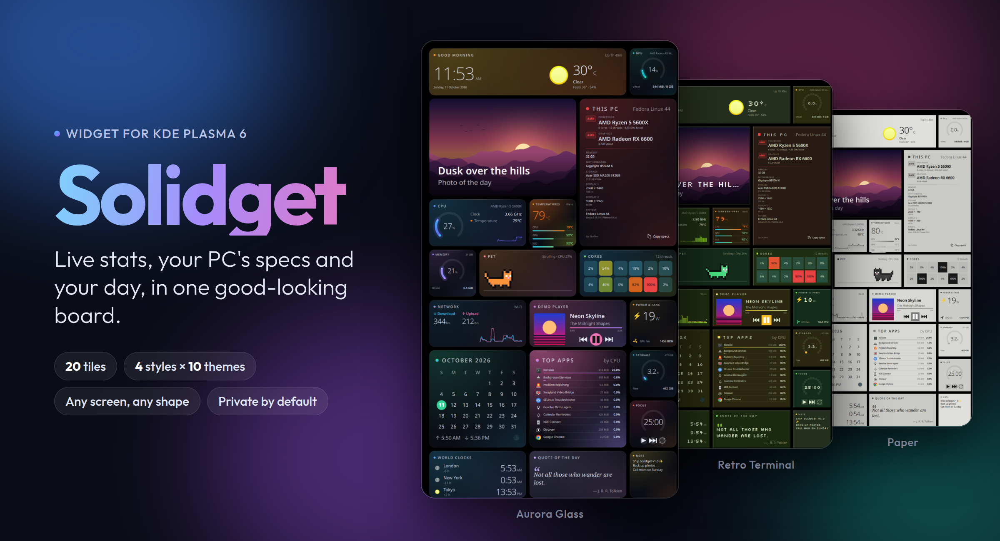

# Solidget

**One solid widget for your KDE desktop.** Live system stats, your PC's specs,
and the little everyday things, all in one good-looking board.



## What you get

- **20 tiles.** CPU, GPU, memory, temperatures, network, storage, fans, top apps,
  clock and weather, calendar, music controls, photo of the day, world clocks,
  focus timer, sticky note, quote of the day, and a pixel cat that reacts to your CPU.
- **Your look.** 4 styles (Glass, Flat, Clear, Pixel) × 10 color themes, or
  pick a ready-made look like *Retro Terminal* or *Paper*.
- **Fits any space.** A corner card, a sidebar, or a whole spare monitor,
  landscape or portrait. Tiles arrange themselves.
- **Arrange it your way.** Drag tiles, resize them, hide the ones you don't need.
- **Private by default.** Your computer name, Wi-Fi name, IP and location are
  hidden, so screenshots are safe to share.
- **Light on your PC.** About 5% of one CPU core with all 20 tiles on (a little more when your PC is busy).

## Install

Works on any Linux with **KDE Plasma 6**: Fedora KDE, Kubuntu 25.04+,
Debian 13, openSUSE Tumbleweed, Arch, Manjaro, KDE neon, Bazzite and more.
Plasma 5 (Ubuntu 24.04, Debian 12) isn't supported.

A tile looks empty? Open **Settings → General → System check**. It tells
you what's missing and the exact command to install it.

**From Plasma (easiest).** Right-click your desktop → **Add Widgets…** →
**Get New Widgets** → **Download New Plasma Widgets**. Search for
"Solidget" and click **Install**. Updates show up in Discover.

**From a file.** Download `solidget-….plasmoid` from the
[latest release](https://github.com/livlign/solidget/releases/latest). Then
**Add Widgets…** → **Get New Widgets** → **Install Widget From Local File**.

Then drag Solidget from **Add Widgets** onto your desktop. Hover over it and
click **Settings** to change the look, the tiles and where it sits.

<details>
<summary>From source (for tinkerers)</summary>

```sh
git clone https://github.com/livlign/solidget.git
cd solidget
./install.sh
```

| Command | What it does |
|---|---|
| `./install.sh` | Install or update, and put it on your desktop |
| `./install.sh --no-add` | Install or update only |
| `./install.sh --place full` | Move it: `full`, `left`, `right`, `top`, `bottom`, `tl`, `tr`, `bl`, `br`, `corner` |
| `./install.sh --ram` | Show your RAM type and speed (asks for your password once) |
| `./install.sh --uninstall` | Remove it |

After updating, restart Plasma to load the new version:
`systemctl --user restart plasma-plasmashell`

</details>

## What goes online

Everything runs on your PC. A few tiles fetch public data, and only when they're shown:

| Tile | Talks to | Why |
|---|---|---|
| Clock & weather | open-meteo.com, ipwho.is | Weather, and your rough location if you didn't set a city |
| World clocks | open-meteo.com | Find a city's time zone, once per city |
| Photo of the day | bing.com | Today's photo, once a day |

No accounts, no tracking, no analytics.

## Help make it better

Bug reports and ideas are welcome in [Issues](https://github.com/livlign/solidget/issues).
Want to change code? Read [CONTRIBUTING.md](CONTRIBUTING.md) first. It's short.

Found a security problem? See [SECURITY.md](SECURITY.md).

## License

GPL-2.0-or-later. The bundled Silkscreen pixel font is under the
SIL Open Font License (see `package/contents/fonts/OFL.txt`).
