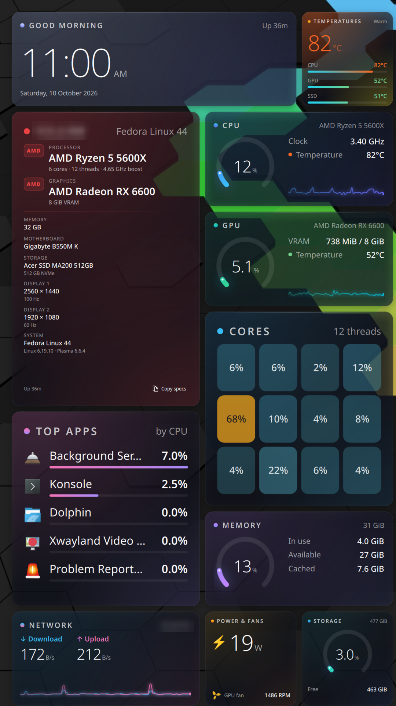

# Solidget

**One solid widget. Everything you need.**

Solidget is a KDE Plasma 6 desktop widget that is useful the moment it lands:
live system stats plus a showcase of your PC's specs, laid out for you, and
customized right inside the widget — no hunting through widget galleries.



- **Aurora glass design** – frosted tiles with soft color glows that brighten
  with load, gradient ring gauges, thin oversized numbers that count smoothly.
- **Fills any space** – a bento layout engine sizes tiles to the space they
  get: a small corner card, a sidebar, or a whole spare monitor, landscape or
  portrait. Tile size: Auto, Compact, Comfortable, Large or Huge.
- **One-click placement** – full screen, halves, quarters, sidebars, corner card.
- **12 tiles** – Clock & date, PC specs (copy to clipboard), CPU, GPU, Core
  heatmap, Top apps, Memory, Temperatures, Network, Power & fans (spinning
  fans!), Storage, Battery.
- **Detects your hardware** – no GPU tile without a GPU, no battery tile on a desktop.
- **Arrange by hand** – hover, click the pencil: drag tiles to move them (the
  others slide out of the way), drag a tile's corner to resize it in grid
  cells, hide tiles with one click. Hand-sized tiles keep their size; the rest
  still auto-fill. *Reset layout* forgets it all.
- **Settings** (from the edit toolbar) – placement, size, presets (Essentials,
  Everything, Showcase, Performance, Everyday, Minimal), weather location and
  unit, per-tile show/hide, order and size. The dashboard behind is the live preview.

## Install

```sh
./install.sh
```

Installs the widget, optionally reads your RAM type/speed (needs `sudo` once),
and places Solidget at the top-right of your desktop.

| Command | What it does |
|---|---|
| `./install.sh` | Install or upgrade, add to the desktop |
| `./install.sh --no-add` | Install or upgrade only |
| `./install.sh --ram` | Re-read RAM type/speed |
| `./install.sh --place full` | Resize it: `full left right top bottom tl tr bl br lthird rthird corner` |
| `./install.sh --uninstall` | Remove from desktops and uninstall |

Requires Plasma 6, `python3`, and `ksystemstats` (all default on Fedora KDE).

## Development

```
package/
  metadata.json             plugin id, name, version
  contents/config/main.xml  saved settings (order, hidden tiles, preset, density, sizes)
  contents/code/specs.py    hardware detection, prints JSON (run it directly to debug)
  contents/code/layout.js   bento layout engine (pure JS, unit-tested)
  contents/code/palette.js  Aurora colors, heat ramp
  contents/code/format.js   number/size formatting
  contents/ui/main.qml      sensors, presets, placement, board, editor
  contents/ui/GlassTile.qml the card every tile is built on
  contents/ui/*Tile.qml     one file per tile
tests/layout.test.js        node tests/layout.test.js
```

After editing, reinstall and reload Plasma (Plasma caches widget QML):

```sh
./install.sh --no-add && systemctl --user restart plasma-plasmashell
```

systemd allows only 3 Plasma restarts per minute; past that the shell stays
down until `systemctl --user reset-failed plasma-plasmashell && systemctl --user start plasma-plasmashell`.
Plasma drops `console.log` from widgets; use `console.warn` when debugging.

For a faster loop, install `plasma-sdk` and preview without touching your desktop:

```sh
sudo dnf install plasma-sdk
plasmoidviewer -a package
```

Logs: `journalctl --user -u plasma-plasmashell -f | grep -i solidget`

### Adding a tile

1. Create `contents/ui/FooTile.qml` with `GlassTile { required property var app ... }`
   (or `GaugeTile` for a ring + details tile). Size text with the tile's `u` so it scales.
2. In `main.qml`, add `foo` to `allTiles` and `tileInfo`, a `Component { id: fooTile; FooTile { app: root } }`,
   and a case in the Loader's `sourceComponent` switch.
3. Add its spans to `SPANS` (and `GROW_PRIORITY`) in `layout.js`, and colors to `palette.js`.
4. If it depends on hardware, add a case to `isAvailable()`.

## License

GPL-2.0-or-later
